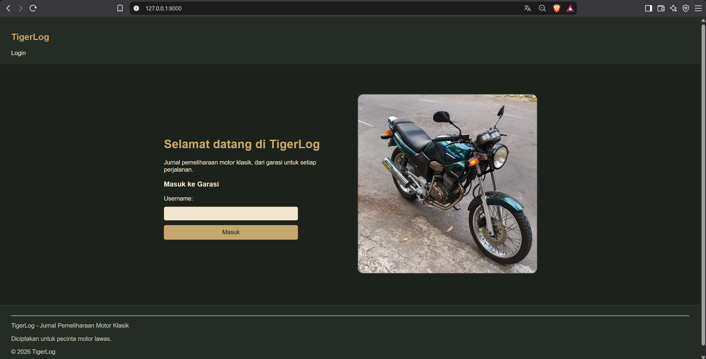
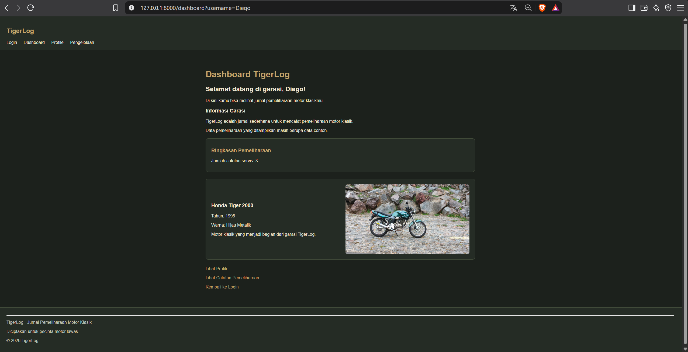
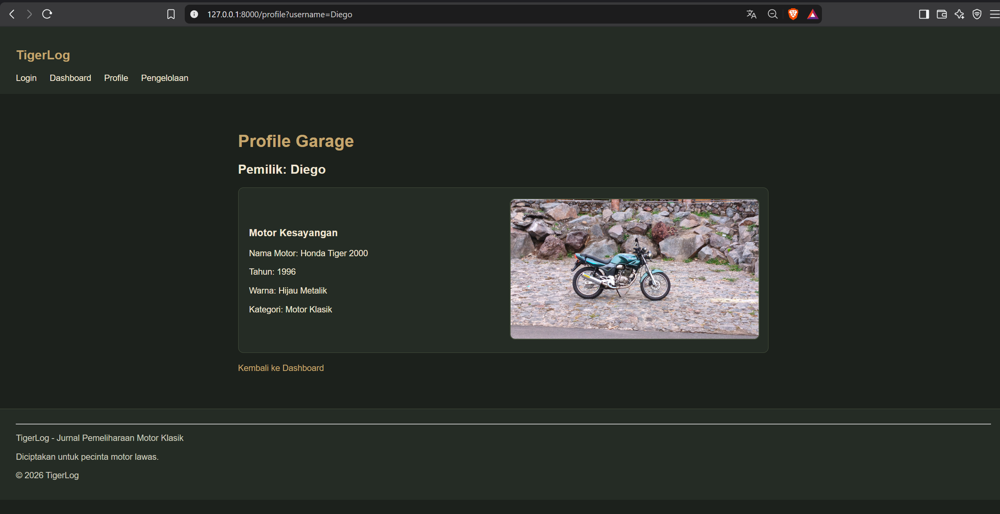
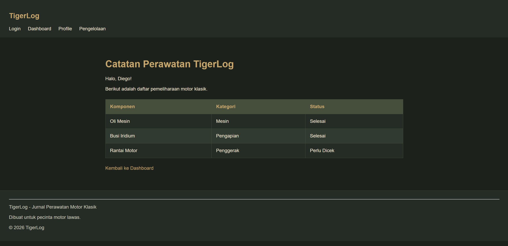

# TigerLog - Jurnal Perawatan Motor Klasik

TigerLog adalah website sederhana yang saya ciptakan untuk tugas UTS Praktikum Pemrograman Web. Website ini berisi informasi Honda Tiger 2000 tahun 1996 milik saya beserta contoh catatan pemeliharaannya.

Saya menggunakan tema Retro Garage dengan perpaduan warna hijau gelap dan emas agar sesuai dengan karakter motor klasik.

## Fitur Website

TigerLog memiliki empat halaman utama:

1. **Login** - Memasukkan username untuk menuju ke Dashboard.
2. **Dashboard** - Menampilkan welcome (sapaan) pengguna, informasi motor, dan jumlah catatan servis.
3. **Profile** - Menampilkan informasi pemilik dan foto Honda Tiger.
4. **Pengelolaan** - Menampilkan daftar pemeliharaan motor dalam bentuk tabel.

## Screenshot Website

### Login

### Dashboard

### Profile

### Pengelolaan

## Teknologi yang Digunakan

- HTML dan CSS untuk membuat tampilan website.
- PHP dan Laravel 13 untuk menjalankan aplikasi.
- Blade Template untuk mengatur tampilan halaman.
- Array PHP untuk menyimpan contoh data pemeliharaan.

## Cara Menjalankan

1. Pastikan PHP dan Composer sudah tersedia.
2. Buka terminal pada folder projek TigerLog.
3. Jalankan `composer install`.
4. Salin `.env.example` menjadi `.env` dengan perintah `copy .env.example .env` pada Windows.
5. Atur `SESSION_DRIVER=file` dan `CACHE_STORE=file` pada `.env`.
6. Jalankan `php artisan key:generate`.
7. Jalankan `php artisan serve`.
8. Buka `http://127.0.0.1:8000` melalui browser.

## Catatan

Website ini belum menggunakan database maupun fitur CRUD. Data servis masih berupa array PHP di Controller, sedangkan halaman Login hanya menerima username melalui Request dan bukan sistem login akun.

Projek ini dibuat untuk mempraktikkan penggunaan Route, Controller, Request, Blade, HTML, dan CSS yang sudah dipelajari.

---

**TigerLog - Dari garasi untuk setiap perjalanan.**
